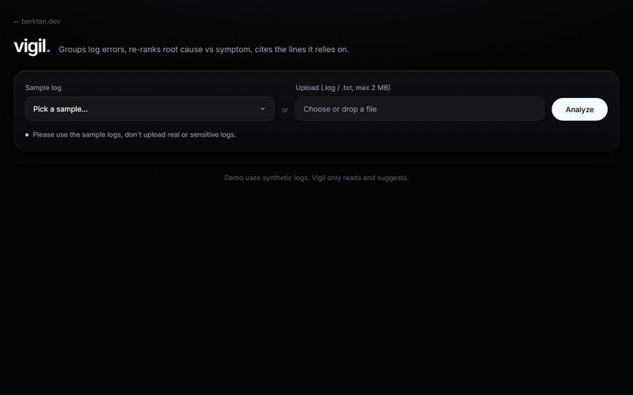
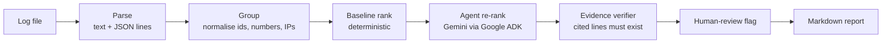
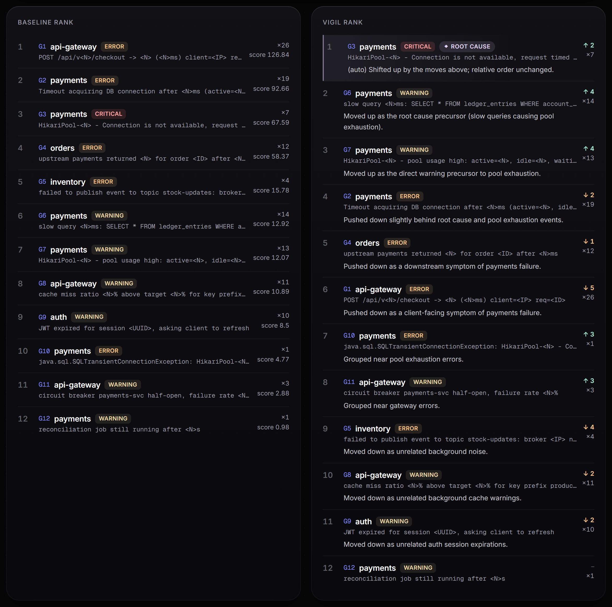
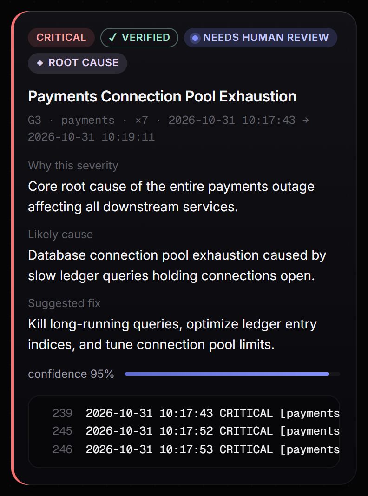
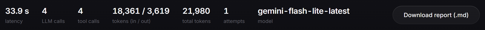
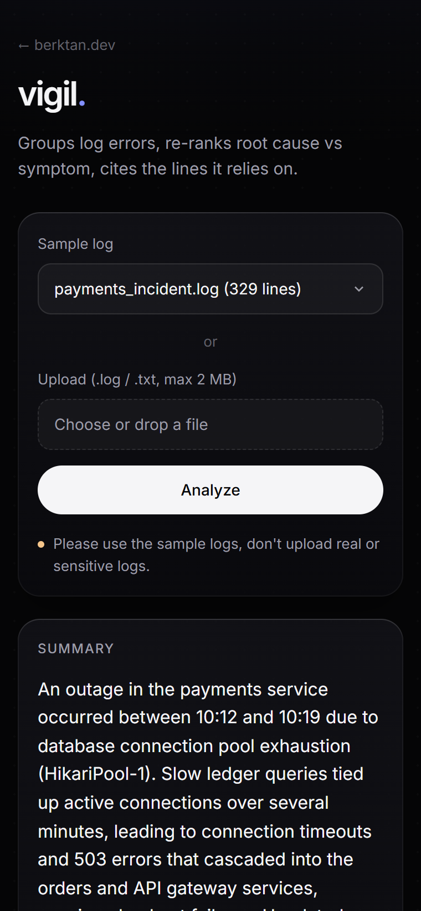

# vigil

**An AI agent that reads server logs, separates root causes from symptoms, and cites the exact lines it relies on.**

[](https://www.python.org/)
[](https://google.github.io/adk-docs/)
[](https://ai.google.dev/)
[](https://fastapi.tiangolo.com/)
[](https://github.com/AkoSuminoe/Vigil/actions/workflows/tests.yml)
[](LICENSE)

> **Built solo during the [GDG London](https://gdg.community.dev/gdg-london/) Agentic Hackathon (AI DevCamp 2026) on 31 October 2026.**
> Everything in this repository was built that day: the agent, the guardrails, the web app, the evals and
> the tests. The [commit history](https://github.com/AkoSuminoe/Vigil/commits/main) runs from 09:34 to the
> final submission.

**Live demo:** https://vigil.berktan.dev · **Repo:** https://github.com/AkoSuminoe/Vigil



## The problem

During an incident, the loudest errors are rarely the cause. A slow query exhausts a
connection pool, and the logs fill with gateway 500s and order timeouts. Sorting by count
or severity puts those symptoms first, and on-call engineers spend the first minutes of an
outage chasing them.

## How it works



1. **Parse and group (Python).** Each line is parsed and normalised: ids, numbers, IPs, emails and
   UUIDs are replaced with placeholders. Lines are then clustered by service and message, and every
   group keeps the line numbers it covers.
2. **Baseline rank (Python).** `score = level weight × count × recency`. It is deterministic and
   explainable, and it is what a dashboard would show.
3. **Agent re-rank (Gemini via ADK).** The agent reads the groups through two read-only tools and
   returns structured JSON:
   - a new ranking, with a reason for every group it moved;
   - a severity, likely cause and suggested fix per group;
   - a confidence score per group;
   - the exact log lines it relies on.
4. **Verify (Python).** Every cited line is checked: it must exist and belong to that group.
   Findings are marked `verified` or `unverified`, never silently dropped.
5. **Escalate (Python).** `needs_human_review = severity == critical or confidence < 0.6`.
6. **Report.** A markdown incident report, plus metrics: latency, LLM calls, tool calls and tokens.

## Key engineering decisions

- **Deterministic baseline vs AI re-rank.** The model never ranks from scratch. It starts from a
  reproducible baseline, and every position change must be justified. The UI shows both columns side by
  side, so the value the agent adds is visible and checkable.
- **Verified evidence.** The model cites line numbers and Python checks them. If a citation is
  hallucinated, the finding is marked unverified with the reason; it is not hidden.
- **Guardrails live outside the model:**
  - **Schema:** the output is validated with Pydantic, along with checks that the ranking is a
    permutation and there is one finding per group.
  - **Retry:** one retry with the validation errors fed back, then a clear error.
  - **Caps:** at most 6 tool calls per turn (hard stop at 8), `max_llm_calls=10`, and an overall
    120 s timeout.
  - **Model fallback:** transient 429/5xx errors are retried with backoff, then the analysis falls
    back to a second model.
- **Read-only by design.** The agent can only read pre-parsed groups. It cannot run commands, read
  arbitrary paths or write files. Suggested fixes are text.
- **Rate limiting.** The limit is per client IP, using a sliding window plus a concurrency cap. It is
  proxy-aware (`CF-Connecting-IP`, then `X-Forwarded-For`) for Cloudflare Tunnel deployments.
- **No uploads on disk.** The request body is capped at 2 MB before parsing and processed in memory.
  Only `.log`/`.txt` files are accepted.

## Results

Three synthetic incidents in [evals/](evals/), each built so that symptoms outnumber the cause.
In every case the baseline ranks the real root cause **6th**.

| Scenario | Baseline #1 (a symptom) | Vigil's root cause | Verified |
| --- | --- | --- | --- |
| `dns_outage` | orders → inventory timeouts | G6 · CoreDNS has no healthy upstreams | 10/10 |
| `expired_internal_cert` | checkout TLS handshake errors | G6 · cert-manager failed to renew the mTLS cert | 10/10 |
| `redis_maxmemory` | auth session write failures | G6 · Redis hit maxmemory (noeviction) | 10/10 |

```
Root cause found: 3/3
Baseline #1 was the root cause: 0/3
```

Each case takes about 28–32 s and 10–21k tokens. The suite has **76 tests**, covering parsing,
ranking, validation, verification, pipeline guardrails and the web API. They need no API key.
[GitHub Actions](https://github.com/AkoSuminoe/Vigil/actions/workflows/tests.yml) runs them on
Python 3.11 and 3.13 on every push.

## Screenshots

| Baseline vs Vigil rank | Finding card with verified evidence |
| --- | --- |
|  |  |

| Metrics | Mobile |
| --- | --- |
|  |  |

## Tech stack

| Area | Tools |
| --- | --- |
| Agent | Google ADK (`Agent`, `Runner`, `InMemorySessionService`), Gemini |
| Validation | Pydantic v2 |
| Backend | Python, FastAPI, Uvicorn |
| Frontend | Vanilla HTML/CSS/JS, no build step; DOM built with `textContent` only; strict CSP |
| Testing | pytest, plus a real-model eval harness |
| Deployment | Docker, or pm2 + Caddy + Cloudflare Tunnel |

## Run locally

Requires Python 3.11+ and a Gemini API key from [Google AI Studio](https://aistudio.google.com/apikey).

```bash
python -m venv .venv
source .venv/bin/activate            # Windows: .venv\Scripts\activate
pip install -r requirements.txt
cp .env.example .env                 # set GOOGLE_API_KEY (save as UTF-8)
```

| What | Command |
| --- | --- |
| Web app | `uvicorn app.main:app --host 127.0.0.1 --port 8100`, then open http://127.0.0.1:8100 |
| CLI | `python -m vigil sample_logs/payments_incident.log [--save] [--json]` |
| ADK dev UI | `adk web` (pick "vigil") or `adk run vigil` |
| Tests | `pytest` |
| Evals (real model) | `python -m evals.run` or `python -m evals.run --case dns_outage` |

**Docker**

```bash
docker build -t vigil .
docker run --rm --env-file .env -p 127.0.0.1:8100:8100 vigil
```

The key is passed at runtime and never baked into the image. The container runs as a non-root user
and has a health check on `/healthz`. Save `.env` with LF line endings: `docker --env-file` keeps a
trailing `\r`.

**Configuration** (`.env`):
- `VIGIL_MODEL` (default `gemini-flash-latest`)
- `VIGIL_FALLBACK_MODEL` (default `gemini-flash-lite-latest`)
- `VIGIL_TIMEOUT_S`
- `RATE_LIMIT`, `RATE_WINDOW_S`
- `MAX_CONCURRENT_ANALYSES`
- `TRUST_PROXY=1` behind a proxy

**Supported log formats:**
- **Text:** `2026-10-31 10:15:02 ERROR [payments] msg`, or the same without the service.
- **JSON lines:** slog, pino, structlog and similar. Common field names are recognised for timestamp,
  level, message and service; pino's numeric levels and epoch timestamps work too.
- **Anything else:** if nothing in a file parses, vigil reports an unsupported format instead of an
  all-clear.

**API:**
- `GET /api/samples`.
- `POST /api/analyze` (multipart `file` or `sample`).
- `GET /healthz`.

## Security notes

- `GOOGLE_API_KEY` stays on the server. It is never sent to the browser and never logged.
- Uploads are capped at 2 MB, limited to `.log`/`.txt` files, never written to disk and never stored.
- Untrusted log text is rendered with `textContent` only. The page runs under a strict CSP
  (`default-src 'self'`, fonts self-hosted) with `X-Frame-Options: DENY` and `nosniff`.
- Requests are rate-limited per client IP, with a cap on concurrent analyses.
- JSON fields such as client addresses and user agents are deliberately left out of the messages,
  so they never reach the model.
- The demo uses synthetic logs only. Don't upload real or sensitive logs.

## What's next

- A canonical, timezone-aware timestamp per entry, for logs that mix formats.
- Multi-line entries, so stack traces attach to the line that raised them.
- More formats: syslog, nginx/Apache access logs, logfmt.
- A nightly real-model eval run in CI, next to the unit tests.
- Streaming progress in the UI while the agent works.

---

**Built solo at the GDG London Agentic Hackathon (AI DevCamp 2026), 31 Oct 2026.**

## Acknowledgements

Some parsing ideas adapted from [silvermete0r/logs_analyzer_script_py](https://github.com/silvermete0r/logs_analyzer_script_py).

Fonts: [Inter](https://github.com/rsms/inter) and [Geist Mono](https://github.com/vercel/geist-font), both under the SIL Open Font License.
